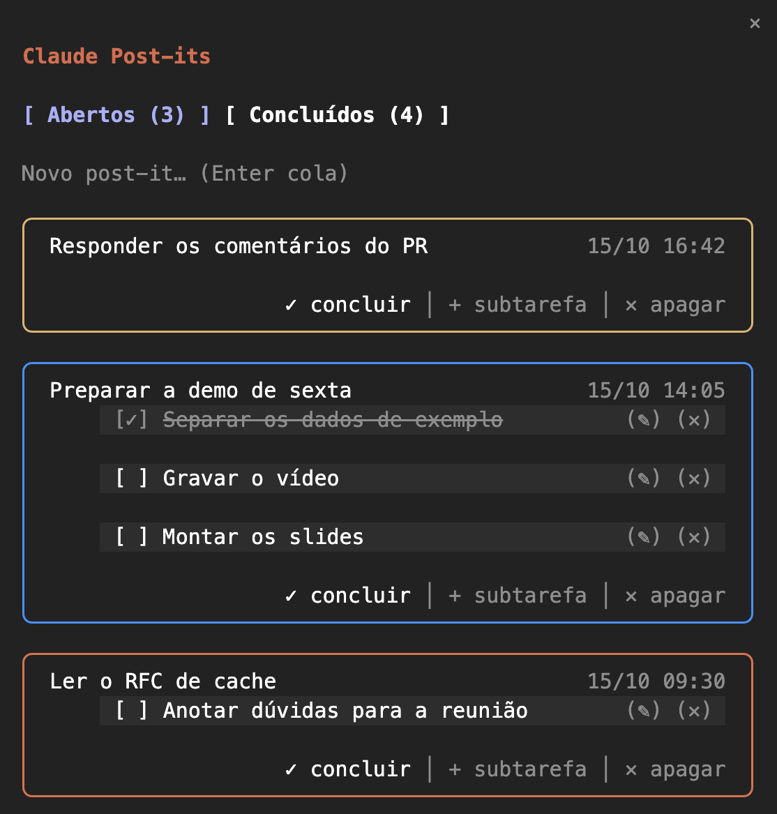

# Claude Post-its

Um mod para o [Claude Code](https://claude.com/claude-code): painel lateral de post-its no terminal.



Enquanto os agentes trabalham na conversa, o painel ao lado guarda a tarefa atual, com uma subtarefa por frente, e as próximas que vêm depois.

- Crie post-its de texto; cada um ganha uma cor (laranja, azul, amarelo, verde, ciano, roxo, em ciclo).
- Subtarefas com checkbox dentro de cada post-it, editáveis (`(✎)`) e removíveis (`(✕)`).
- Marque como concluído e consulte o histórico na aba **Concluídos**, com a data.
- Cada pasta tem o seu quadro: abrindo o Claude Code em outra pasta, você vê outros post-its. Eles ficam salvos entre sessões.

## Instalar

Numa sessão do Claude Code no terminal:

```
/plugin install post-its --marketplace DiogoGRS/claude-post-its
```

Responda `y` para adicionar o marketplace e escolha o escopo de usuário. O mod fica ativo na hora e em toda sessão seguinte.

## Usar

- `/postits` abre ou fecha o painel.
- O painel fica na lateral com o Claude Code em tela cheia e o terminal com 110 colunas ou mais. Com o terminal mais estreito ele se esconde e volta sozinho quando o terminal alarga.
- Ao abrir, o foco vai para o campo de novo post-it; `Esc` devolve o teclado ao prompt.

### Largura

Quem decide a largura da lateral é o Claude Code: 45% do terminal (até 90 colunas), ou a largura que você arrastar na borda do painel, que ele guarda em `~/.claude.json` (`pluginPanes.dockColumns`) e lê ao iniciar.

## Onde ficam os dados

Os post-its ficam no store do plugin, em `~/.claude/plugins/store/`, fora deste repositório, guardados pela pasta onde a sessão começou. Um `/cd` no meio da sessão não troca de quadro; a próxima sessão aberta na outra pasta mostra o quadro dela.

## Desenvolver

```
claude --plugin-dir .            # carrega o mod desta pasta numa sessão
claude plugin validate .         # confere o manifesto e o módulo
claude plugin test .             # roda tests/*.test.ts
```

Os tipos da API (`.claude-plugin/types/`) são gerados pelo Claude Code ao carregar o mod; depois disso `tsc -p .` checa os tipos.

## Licença

[MIT](LICENSE)
